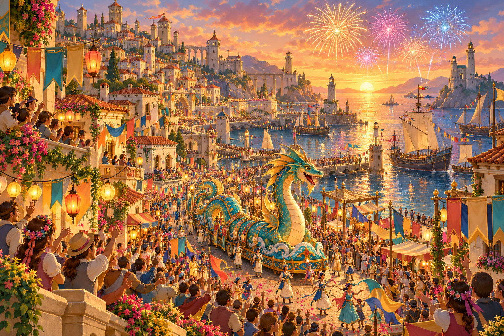

# The Tide Festival

| | |
|---|---|
| **Tier** | Tier 2 |
| **Party Level** | **4 PCs at Level 6** — Naan (Lilli), Nalith (Piper), Kto (Kaitlyn), Yinu (Sev) |
| **Duration** | ~2 hours |
| **Setting** | **New Sarshel**, Impiltur — the salt road east of the dark Sarshel Light, the Landward Gate, and the city's Tide Festival. Canon: *FR Campaign Guide* p. 145; *Player's Guide* p. 107 |
| **Hook From** | **End of Session 007** — the lighthouse is dark, Veyra's ledger is in the party's hands, and the *Embergull* survivors need an escort nine miles east |
| **Tone** | Upbeat and heroic, with real villains. The city is warm and the friends are funny; the people behind Veyra are not |

## Adventure Summary

The heroes who put out the lighthouse walk into **New Sarshel** on the first day of its yearly **Tide Festival** ⚗️, and the whole city cheers them through the gate. But Veyra's ledger is exactly as bad as it looked in the lantern room. The people who paid her are the **Gilded Gull Club** ⚗️, three nobles of **Gull Row**, whose seaside mansions the retreating sea left a mile from the water. Veyra sold them "**the Summoning**": a demon of the deep to drag the tide home, paid for in coin and in lives the light lured off the salt road. Their leader, **Lord Percival Gullwhistle**, knew the price and paid it anyway.

The session is a bright day at the fair with a villain moving through it. Gullwhistle's hired wreckers try to take the ledger on the road. In the city he plays the gracious host, offers to buy the book, and then quietly threatens the party. At sunset he reads Veyra's last scroll at the Grand Parade. The club's giant clockwork sea serpent wakes with brass teeth, and his clockwork gulls dive for the ledger in the chaos, so that "the lighthouse witch's curse" gets the blame. The party saves the crowd, stops the float, and decides whether Gullwhistle faces the Grand Council or gets away across the harbor. The night ends with fireworks, new homes for the survivors, a harbor light for Tamsin, and a ship ready to take the party anywhere on the Sea of Fallen Stars.

**Canon used:** New Sarshel is the one Impilturan port that kept pace with the retreating Sea of Fallen Stars and won the region's trade; people from shrinking towns have moved there (*CG* p. 145, *PG* p. 107). **Everything else** — the festival, the Gull Club, the Bracks, the float, Tibbet, the Hall of Many Lights, the freed prisoners' names — is a **DM addition ⚗️**.

## Tone Rules — for every scene

- **The day is upbeat; the villains are real.** Gullwhistle and the Brack Brothers lie, threaten, and fight to win. Play them straight: no pratfalls, no giving up because it's funny. Combat uses the normal rules, including death saves.
- **The lightness comes from everyone else.** The walkers, Warden Plumm, Brother Amsel, Tibbet, Captain Lorrow, and the games are warm, quirky, and funny. Lean on them between the tense moments.
- **Danger is real but not grim.** Bystanders can be hurt if the party can't reach them, but nobody dies on screen and there is no gore. Telegraph every threat before it lands.
- **Every PC gets a win.** Each scene names a spotlight for a specific PC. Fiorn is not here (Fox has moved to his own game) — do not write him in.
- **The light lied; the festival gives back.** In Session 007 the beam showed each PC a false version of their heart's desire. Today each PC can get a small, *true* piece of it (see Scenes 1.2, 2.1, and 2.2). These are offers, not requirements.
- **Veyra's master stays a mystery.** Gullwhistle only paid her; he doesn't know who she served. See *Threads Left Open*.

## The Day's Shape

| When | Where | Scene | What happens |
|---|---|---|---|
| Early morning | The salt road, ~6 miles east of the tower | **1.1** | The walk east; the Brack Brothers' roadblock (**Encounter 1**, avoidable) |
| Late morning | The Landward Gate | **1.2** | Heroes' welcome on **Lantern Eve**, the festival's opening day; beds, supper, harbor lanterns at dusk; **long rest overnight** |
| Noon, Tide Day | The Hall of Many Lights | **2.1** | The Noon Bells; blessings; a priest reads the ledger |
| Afternoon | Festival Green | **2.2** | Games; meet the Gulls; Gullwhistle's offer and threat |
| Sunset | Harbor Way parade route | **3.1** | The Grand Parade; the float wakes (**Encounter 2**) |
| Nightfall | Harbor plaza | **3.2** | Fireworks, justice, rewards, a ship's offer |

**Rest.** The party has not rested since Session 006 (the DM confirmed it at the start of Session 007). A **short rest** is available on the road before the roadblock (the survivors stop for breakfast). The **long rest** comes on Lantern Eve night in the beds Warden Plumm finds them, so the party starts Tide Day fully rested for the parade.

## What's Really Going On (DM only)

- **The Gilded Gull Club** is three nobles from **Gull Row**, the old waterfront street of New Sarshel's first harbor. The sea kept retreating and the city built new docks to follow it — and Gull Row was left a mile inland, its piers standing over dry sand, its families' fortunes going with the trade.
- **Veyra** came to them a year ago. A demon of the deep, she said, could drag the tide back to Gull Row. The price was **400 gp apiece** — and "the light will need feeding" until the tide turned: travellers lured off the salt road.
- **Lord Percival Gullwhistle** understood exactly what that meant and agreed. He told the other two it was "a summoning of the tide," and that the lighthouse was only Veyra's workshop.
- **Lady Marisol Brightwater** believed him. She never asked what the light was for. When she learns about the prisoners she will be horrified.
- **Sir Dunstan Pellow** overheard Veyra say *"the light needs feeding"* and chose not to ask. He is a coward, not a monster, and pressure cracks him.
- **Last night**, Gullwhistle's footman watched the lighthouse from Gull Row with a spyglass and saw the light go out. Gullwhistle knows Veyra failed, and that her papers could put him in front of the Grand Council. Before dawn he hired the **Brack Brothers** to stop anyone coming from the lighthouse and take every book and paper they carry.
- **Veyra left him two things:** a ***Scroll of the Rising Tide*** ⚗️, "to be read when the sea returns" (really a scroll that animates a large object), and a short letter in Common: *"The light will need feeding until the tide turns. You agreed the price. — V."* He keeps both in his coat.
- **His fallback plan** for the parade: the heroes ride at the front; he reads the scroll and wakes the club's float; his **clockwork gulls**, which obey his silver gull-whistle, snatch the ledger in the chaos; the city blames "the lighthouse witch's curse." If it all goes wrong, his rowboat waits at the quay steps below the harbor plaza.

---

## Act I — The Road In

### Act I, Scene 1.1 — The Salt Road

**Purpose / transition:** Pick up exactly where Session 007 ended, introduce the survivors as warm, funny company, and put a real obstacle on the road. Whatever happens, the party learns someone in the city wants the ledger badly: *a gent with a golden bird pin and a gull feather in his hat*, who signs himself **"G."**

#### Setting
- **Location:** The pale coast road across the dry seabed, from the dark Sarshel Light east toward New Sarshel. Session 007 cut as the column set out from the tower; the sun comes up on the road. The roadblock stands about six miles along, in the early morning.
- **See:** A white, cracked salt flat glittering in the sunrise; stranded old ships far off on the salt; behind the party, the lighthouse standing dark at last; ahead, the towers of a city on the horizon. Then, across the road: an old salt-collector's hut with fresh salvage stacked around it, a striped gate pole down across the road, three men waiting, and something big shifting in a washtub of brine.
- **Hear:** Bram's sea shanties, the donkey's complaints, the creak of Dagna's pickle wagon, gulls. At the hut: the click of claws, and a man calling out pleasantly for everyone to stop right there.
- **Smell:** Salt, dust, dill pickles, breakfast smoke; tar and old rope from the salvage.
- **Sense:** **Insight DC 13** — these men have done this before; the salvage is from wrecks they stripped, and they are counting the party, not the walkers. **Perception DC 13** — a third brother is waiting behind the salt barrels, and the crab in the tub wears a rope harness.

#### NPCs

##### The walkers (survivors and freed prisoners)
- **Disposition going in:** Grateful, chatty, and in awe of the party. Roughly fifteen people: **Oren** and the *Embergull* camp (ordinary folk with packs), **Tamsin Reed**, and the four freed prisoners, named here for the first time ⚗️:
  - **Bram Tolliver** — an old sea-shanty singer. Starts a song whenever anyone says "sea," "ship," or "water."
  - **Hettie Quillfeather** — a halfling mapmaker who has spent ten years mapping *where the sea went*. Her map shows Gull Row stranded a mile inland. She can supply this clue in 2.2.
  - **Dagna Stoutbarrel** — a dwarf pickle-maker who was hauling barrels to the festival's pickle contest when the light lured her. Her wagon was stuck at the camp; the party can help dig it out.
  - **Wren Ashby** — a young apprentice baker who has never seen a city. The party's number-one fan; asks for autographs.
- **Motivations:** Get to the city safely; thank the heroes; enter Dagna's pickles in the contest.
- **Possible outcomes and effects:** If the party is kind to them on the road, they spread the story everywhere. At the roadblock the walkers pull back 60 ft and huddle around Dagna's wagon. Whatever happens there, **Wren slips off across the salt and runs ahead** to the city — for help if there's a fight, with the news if not (she is fast and cannot keep a secret) — which is why the gate cheers in 1.2. If **Sev says Yinu never grabbed her staff and pack in the lantern room**, Tamsin hands them over now — she brought them down.

##### The Brack Brothers ⚗️
- **Disposition going in:** Confident and businesslike. Salt-road wreckers who strip stranded ships and anyone who crosses the flats alone. **Mort** (lean, black moustache, weighted net, does the talking — polite, and never means it), **Ned** (wiry, squinting, a sling and a bandolier of lead shot; says almost nothing), and **Ollie** (huge and bald, the muscle, devoted to his brothers), plus **Clacker**, their harnessed giant crab, who hauls salvage.
- **Motivations:** A "gent from the city" paid them 25 gp before dawn, with 50 more on delivery: *take every book and paper from the lighthouse folk, and see nobody from the lighthouse reaches the city to tell tales.* They don't know or care why. They take pride in a clean job.
- **Possible outcomes and effects:**
  - **Hand over the real ledger** — Mort checks it, smiles, and lets everyone through. (See *Conditional follow-through* for how the story still works without it.)
  - **Buy them off** — they were promised 75 gp in all. **Persuasion DC 13** with an offer of 50 gp or more (automatic at 100 gp). Mort shrugs: "A better offer is a better offer."
  - **Bluff them** — a decoy bundle of papers: **Deception DC 14**. If it works they head for the city without a word, and Gullwhistle learns of the trick by the afternoon (see 2.2).
  - **Scare them off** — **Intimidation DC 15**, with advantage if the party shows real power first (a spell, a shot that splits the gate pole). Mort decides this job isn't worth dying for.
  - **Fight** (**Encounter 1**, below) — they fight to win. They surrender when Mort drops or two brothers are down.
  - **Every outcome:** anyone who gets close to Mort sees the purse he's been paid from — teal silk, a gold gull stitched on it. No roll needed.
  - **If they are beaten, bought, or scared off**, the Bracks talk (Mort, or his brothers if he's down): *"A gent from the city. Golden bird pin on his coat, a gull feather in his hat. Fine voice. Paid in good gold."* In Mort's coat is the gent's note, in an elegant hand on expensive paper: *"Every book and paper from the lighthouse folk. Fifty more on delivery. — G."* The Bracks don't know his name.

**Encounter:** **Encounter 1 — The Brack Brothers' Roadblock** (File 2). Avoidable; Medium.

**Conditional follow-through:**
- **If the Bracks were bought off, scared off, or bluffed, or surrendered and were let go:** they still want the 50 gp they were promised. They turn up at the Grand Parade to collect it from Gullwhistle, and when the float wakes, Mort decides he wasn't paid enough to watch children get crushed: they **clear one crowd group on round 2** of Encounter 2.
- **If the Bracks surrendered and the party took them in:** the walkers help march them to the gate, and the watch takes them in 1.2. By Tide Day they are in the stocks on Festival Green in 2.2. When Gullwhistle walks past, Mort shouts across the green: *"Oi! G! You owe us fifty!"* — naming their employer in front of everyone.
- **If the Bracks fled** (Ned and Ollie may run if Mort is down and the way is open): they are gone; they play no further part.
- **If the party handed over the real ledger:** the Bracks deliver it to Gullwhistle by noon. Amsel can't read it in 2.1, but the gull purse still leads to the Gulls (he knows whose colors those are), and Marisol's confession in 2.2 is enough to expose the club. The ledger is in Gullwhistle's coat in 3.1, and the gulls have no ledger to chase (they attack PCs instead). If he is captured, it is recovered as evidence in 3.2.
- **Every branch:** the party has seen the **teal-and-gold gull purse**. If the Bracks talked, they also know **"golden bird pin, gull feather in his hat"** and the signature **"G."** That is the thread to Scenes 2.1 and 2.2.

### Act I, Scene 1.2 — Heroes at the Gate

**Purpose / transition:** Pay off the party's good deed with a big, warm welcome, house the survivors, explain the festival, and give everyone the long rest they badly need. The festival schedule becomes the session's map.

#### Setting
- **Location:** The **Landward Gate** of New Sarshel and the streets just inside. It is **Lantern Eve**, the festival's opening day.
- **See:** A crowd at the gate (Wren in front, jumping up and down); strings of bunting; paper lanterns going up on every balcony; workers hammering stalls on Festival Green; down at the harbor, the new docks crowded with ships. On the far side of the city, the long empty piers of **Gull Row** stand over dry sand.
- **Hear:** Cheering, a brass band warming up badly, a town crier announcing tomorrow's schedule, a fiddle somewhere.
- **Smell:** Fried dough, roasting nuts, sea wind from the new harbor.
- **Sense:** **History DC 12** or asking anyone — the Tide Festival celebrates the year New Sarshel "caught the sea": when the water drew back, the city built new docks to follow it, and it has prospered ever since. Gull Row was the old harbor, and its families have never forgiven the city for moving on.

#### NPCs

##### Warden Bettina Plumm ⚗️
- **Disposition going in:** Thrilled. A brisk halfling festival warden with an enormous clipboard, a whistle, and opinions about bunting.
- **Motivations:** Run a perfect festival. Now she has *real heroes* for it.
- **Possible outcomes and effects:** Finds beds for every survivor and the party at **the Salty Pelican** inn, free. Hands the party the festival schedule (*Handout — The Tide Festival Schedule*, File 3) and invites them to ride at the front of tomorrow's Grand Parade. **If shown the ledger, the "G." note, or told about the gull purse**, she goes quiet: "Gold gulls — that's the Gilded Gull Club. And Lord Gullwhistle sits on my festival committee." She can't accuse a lord of Gull Row on a festival day without proof, and asks the party to bring it, ideally before the parade. Until then: *"Keep that book out of sight. Gull Row has long arms."* **She is the person who can bring in the watch and the Grand Council in 3.2.**

##### Tamsin Reed
- **Disposition going in:** Warm, tired, glad to be free. She has kept a light for twenty years and does not know what to do with her hands.
- **Motivations:** Make sure the survivors are housed; find a use for herself.
- **Possible outcomes and effects:** Mentions the harbor's own light is badly kept ("a candle in a jar, that one"). Sets up her new job in 3.2.

**Encounter:** None

**Lantern Eve, at dusk (optional, gentle).** Everyone floats a paper lantern on the harbor for someone they miss or something they hope for. **Nalith's spotlight:** in Session 007 the light showed her Christmas with her late mother; here she can float a lantern for her mother. Keep it short and sweet, and only if Piper wants it.

**Conditional follow-through:**
- **If the party showed Warden Plumm the ledger, the note, or the purse clue:** in 2.2 she finds them on Festival Green and points out the three Gulls by name — no searching needed.
- **If the party mentioned the gull purse or the golden-pin clue to anyone in the city:** they hear that "the Gilded Gull Club wears gold gull pins — those Gull Row families."
- **Long rest** overnight at the Salty Pelican. The party starts Tide Day fully restored.

---

## Act II — The Festival

### Act II, Scene 2.1 — Bells and Blessings

**Purpose / transition:** A warm, quiet scene before the noise. The church thread from Session 007 pays off, each PC can get a gentle blessing, and a priest reads the ledger closely enough to name the club and the phrase *"for the Summoning."* That sends the party to the games to find the Gulls.

#### Setting
- **Location:** **The Hall of Many Lights** ⚗️ — New Sarshel's big, friendly temple, with an altar for every god anyone in the city has ever prayed to, and one small unmarked altar *"for the gods we haven't met yet."*
- **See:** Hundreds of candles; stained glass with every color of sea; families in festival clothes; a children's choir lined up and fidgeting.
- **Hear:** The **Noon Bells** — every bell in the city at once — then the choir.
- **Smell:** Beeswax, incense, flowers, festival bread blessed at the door.
- **Sense:** **Religion DC 10** — the unmarked altar welcomes any god, including ones no priest in the Hall knows by name (useful for Kto's god, Naan's patron Zophiel, or anyone else's).

#### NPCs

##### Brother Amsel Tidewell ⚗️
- **Disposition going in:** Kind, curious, and a bit nosy. A round, cheerful priest who keeps the unmarked altar and remembers everyone's name.
- **Motivations:** Welcome every visitor; thank the heroes; see justice done for the people the light took.
- **Possible outcomes and effects:**
  - **Mass / service:** The PC who has been missing mass (on the Session 007 tape this is most likely **Naan** — confirm with Lilli and Kaitlyn) gets the full service and a blessing. If they joke about being "fired," Amsel laughs: *"Nobody here is fired. Gods keep a long list of the people who showed up when it was hard."* **Naan's spotlight:** in the Hall's quiet, the voices go still for a while — the white room the light promised, for real.
  - **Kto's spotlight:** the light showed Kto recognition from her god. Amsel asks the heroes' names for the blessing and reads them out to the whole Hall; the crowd cheers, Kto's name first if she wants it.
  - **Reading the ledger:** he spots what the party never had time to notice: the three names are all **Gull Row** families, "G.G.C." is the **Gilded Gull Club**, and every payment says *"for the Summoning."* His smile goes. *"Marisol Brightwater cries at my altar every tenday over her dry pier. Percival Gullwhistle has never once set foot in this Hall. Whatever they paid for, one of them knew."* All three will be at the games — they never miss a chance to be seen.
  - **If the party handed the ledger to the Bracks:** Amsel recognises the gull purse (or Mort's description) at once: *"Teal and a gold gull — that's the Gilded Gull Club, Gull Row's old families. Percival Gullwhistle runs it, and he signs his letters 'G.'"*
  - **A gift:** two **potions of healing** from the Hall's stores, "for heroes who keep running toward trouble."
  - **Optional:** he offers to send a letter home to Shadowdale by the next ship, if the party wants to warn anyone about the drow.

**Encounter:** None

**Conditional follow-through:**
- **If the party tells Amsel about Veyra's demon and the prisoners:** he takes it seriously. A demon fed on travellers is not a small thing; the Hall will care for the four freed prisoners, and whoever paid for it *"knew what they were buying, or chose not to know."*
- **If the party skips the Hall:** Brother Amsel finds them on Festival Green in 2.2 handing out blessed bread, and reads the ledger there.
- **Either way:** the party knows **the Gilded Gull Club**, **Gull Row**, and the phrase **"for the Summoning."**

### Act II, Scene 2.2 — Festival Games and the Gilded Gulls

**Purpose / transition:** The fun centre of the session — and the moment the villain shows his face. Every PC gets a game to win while the party meets the Gulls, hears Gullwhistle's offer and his threat, and gathers proof. What the party learns and who they win over here changes the Grand Parade.

#### Setting
- **Location:** **Festival Green**, a big lawn by the old seawall, packed with stalls and games, with Gull Row's stranded piers in plain view.
- **See:** An archery range with straw gulls as targets; a sand track for crab races; a pickle-eating stage (Dagna's barrels on it); Tibbet's fireworks cart in a roped-off corner; and the three **Gilded Gulls** in teal-and-gold finery and golden gull pins, holding court under a striped awning. Two brass **clockwork gulls** perch on the awning's poles. Beyond it all, the club's parade float: a giant painted **clockwork sea serpent** being polished for tonight.
- **Hear:** Barkers, cheering, a crab announcer, Bram singing, and Lord Gullwhistle's easy laugh — and now and then a thin silver whistle, at which the clockwork gulls turn their heads.
- **Smell:** Dill, sugar, fried fish, gunpowder near Tibbet's cart.
- **Sense:** **Detect Magic** — faint transmutation from a scroll in Gullwhistle's coat, and a faint conjuration glimmer from a sea-glass charm on his watch chain. **Arcana DC 13** on the float — it is full of clockwork, but there is nothing magic about it (yet).

#### The games (pick any; each is a quick roll or two)
- **Kto — the Archery Contest.** Three rounds against the city's best. Ranged attack rolls against AC 15, 17, 19; win two of three to take the Champion's Sash. Kto's +9 longbow is made for this.
- **Nalith — the Crab Races.** Pick a crab (Animal Handling DC 12 to choose a fast one; a druid may simply *ask* the crabs). Win and the crab, **Admiral Snips**, decides it lives with Nalith now.
- **Yinu — Tibbet's Fireworks.** Tibbet's finale rockets are mixed up. Arcana DC 13 (or any clever plan) sorts them. Tibbet teaches Yinu a fireworks trick — **the real lesson the light faked with Elminster** — and gives her a scroll (see *Loot*).
- **Everyone — the Pickle-Eating Contest.** Constitution saves, DC 10, then 12, then 14; last one standing wins Dagna's Golden Gherkin. **No pickled eggs** — a certain hero's religion forbids them.

#### NPCs

##### Lord Percival Gullwhistle ⚗️
- **Disposition going in:** Gracious, witty, and completely in control. Slim and elegant, silver-streaked ginger beard, teal-and-gold coat, a gull feather in his tricorn, a gold gull pin, a rapier he clearly knows how to use. He greets the party as "the lighthouse heroes," shakes every hand, and remembers every name.
- **Motivations:** Get the ledger and the letter destroyed; keep his name clean; still, somehow, get the sea back to Gull Row.
- **Possible outcomes and effects:**
  - **The offer:** he offers to buy the ledger "for the city archives" — 100 gp, then 300.
  - **The threat:** if refused, he smiles and lowers his voice: *"New Sarshel can be a dangerous city for strangers carrying stolen books. I would hate for the heroes of the hour to have an accident on their big night."* **Insight DC 14** — he isn't nervous at all; he is deciding what to do about you.
  - **If the Deception decoy fooled the Bracks:** he knows by now. He is colder, and mentions "a bundle of fish-wrapping" with a thin smile.
  - **He never confesses.** Accused, he laughs it off and asks for proof in front of the crowd.
  - **His coat:** the *Scroll of the Rising Tide* and Veyra's letter. **Sleight of Hand DC 15** to lift them (see *Conditional follow-through*).

##### Lady Marisol Brightwater ⚗️
- **Disposition going in:** Polite, a little sad, and nervous around Gullwhistle. She misses swimming off her own pier.
- **Motivations:** The sea back; to not be a bad person.
- **Possible outcomes and effects:** The weak link. **Persuasion DC 12**, a kind word away from Gullwhistle, or ***Charm Person*** (which works fine out of combat) gets her side of it: Veyra promised to "summon the tide home"; they paid 400 gp each; Percival handled everything with Veyra. **Told about the prisoners**, she goes white, then furious, and **switches sides**. She will repeat it to Warden Plumm, and she knows the float's secret: **the big brass wind-key on its back turns it off.**

##### Sir Dunstan Pellow ⚗️
- **Disposition going in:** Blustering; waves a cane; keeps glancing at Gullwhistle.
- **Motivations:** Sail his yacht from his front door again; never be blamed.
- **Possible outcomes and effects:** **Insight DC 12** — he is frightened, and not of the party. **Intimidation DC 13** (or Persuasion DC 15 with Marisol's confession in hand) cracks him: *"Percival said the light needed feeding! I didn't ask what that meant. I didn't want to know!"* That is the proof that Gullwhistle knew.

##### Tibbet Sparkwright ⚗️
- **Disposition going in:** Delighted by anyone who likes explosions; talks a mile a minute and laughs at her own singed eyebrows.
- **Motivations:** A perfect finale.
- **Possible outcomes and effects:** Overheard Gullwhistle behind her cart this morning, telling his footman: *"The heroes ride at the front. When the serpent wakes, see that the book goes into the harbor with them."* She didn't understand it, and repeats it to anyone who helps with her rockets.

##### Hettie Quillfeather
- **Disposition going in:** Eager to show off her map.
- **Possible outcomes and effects:** Her map shows Gull Row a mile inland and the Gull Club's piers over dry sand — **the "why"** in one picture.

**Exposing the club.** The party **exposes** the Gulls if they make the case to Warden Plumm (or the crowd from the pickle stage) with the ledger plus **one** of: Marisol's confession, Dunstan's admission, Veyra's letter, or the Bracks naming "G." in the stocks. Plumm can't arrest a lord without the Grand Council, but she can strip him of his parade place and set the watch on him. There is no wrong way to do it.

**Encounter:** None

**Conditional follow-through:**
- **If the party exposed the club:** Gullwhistle slips his watchmen at sunset, climbs onto the float as the parade forms, and reads the scroll openly from its back: *"If the sea won't come for me, it can come for you."* **3.1 happens, and he starts aboard.**
- **Otherwise:** Gullwhistle watches from the grandstand and reads the scroll quietly under the noise of the band, as Tibbet's overheard warning promised. **3.1 happens either way.**
- **If Marisol switched sides:** in 3.1 she shouts the wind-key secret on round 1, and climbing onto the float is automatic for the first PC who tries.
- **If the party lifted the scroll and letter:** the letter is proof (it counts toward exposing the club). Gullwhistle reads a *second* copy of the scroll — Veyra left him two — from the grandstand.
- **Spotlight wins carry forward:** Kto's sash, Admiral Snips, Tibbet's scroll, and the Golden Gherkin all appear in 3.2.

---

## Act III — The Grand Parade

### Act III, Scene 3.1 — The Serpent Wakes

**Purpose / transition:** The big set-piece fight. The float wakes with real teeth, the party saves the crowd and stops it, and Gullwhistle makes his last try for the ledger — or his escape.

#### Setting
- **Location:** **Harbor Way**, the parade route, from the top of the street down to the harbor plaza and its big fountain. The party is at the front of the parade (Warden Plumm insisted).
- **See:** Cheering crowds in the grandstands; a pickle stall; a puppet show for little kids by the fountain; confetti cannons on the corners; the **Grand Sea-Serpent Float**, teal and gold, rolling into place behind the party. The two clockwork gulls circle overhead.
- **Hear:** A brass band, cheering, a silver whistle — then a deep grinding of gears, and a hiss of steam from inside the serpent.
- **Smell:** Gunpowder, sugar, sea air, then hot brass and steam.
- **Sense:** **Perception DC 15** (automatic for anyone watching him because of Tibbet's warning) — Gullwhistle in the grandstand's front row, reading from a scroll that crumbles to glowing ash. **Arcana DC 12** once it wakes — the scroll animated the float; it isn't the sea or a demon, but those brass teeth are real. ***Dispel Magic*** can end it (File 2).

#### NPCs

##### Lord Percival Gullwhistle
- **Disposition going in:** Calm and smiling if he's unexposed in the grandstand; coldly furious if he was exposed and is riding the float.
- **Motivations:** Get the ledger (his gulls go for whoever carries it); failing that, escape to his rowboat at the quay.
- **Possible outcomes and effects:**
  - **Fights** with his rapier when cornered; whistles orders to the gulls.
  - **Escapes** if he leaves the map by the harbor plaza's south edge (his rowboat is at the quay steps); his Sea-Glass Charm lets him vanish 30 ft once. Telegraph the boat: anyone looking south sees an oarsman waiting.
  - **Surrenders** if reduced to 15 HP or fewer with no way out: *"I yield. I am a lord of New Sarshel. I demand the Council."*
  - **Captured or knocked out:** the scroll ash, Veyra's letter, and (if the gulls brought it to him) the ledger are on him.

**Encounter:** **Encounter 2 — The Grand Sea-Serpent Float** (File 2). Hard.

**Conditional follow-through:**
- **If the Bracks went free in 1.1:** they arrive to collect their fifty, see what's happening, and clear one crowd group on round 2.
- **If Marisol switched sides in 2.2:** she shouts the wind-key secret on round 1.
- **However the float stops** (smashed, dispelled, or wound down), it ends in the fountain with a long dying whistle of steam.
- **Gullwhistle captured, surrendered, or knocked out** → justice in 3.2. **Escaped** → he's gone across the harbor; a villain who can return.
- **Crowd groups saved** (0–3) carry into 3.2's cheers and rewards. Groups that scattered were hurt; nobody died, and the Hall's healers see to them overnight.

### Act III, Scene 3.2 — Fireworks and Justice

**Purpose / transition:** The happy ending, earned. The city sees what Gullwhistle did, the survivors get new homes, everyone is rewarded, Tamsin gets a new light, and a ship offers to take the party anywhere — the hook for the next session.

#### Setting
- **Location:** The harbor plaza, around the fountain, at nightfall.
- **See:** The float in pieces in the fountain; the watch arriving with lanterns; the crowd pressing in; Tibbet's finale rockets lighting the sky over the new harbor; ships' lanterns on the water.
- **Hear:** The biggest cheer of the day, Bram leading the whole plaza in a shanty, fireworks.
- **Smell:** Gunpowder, wet canvas, hot brass, pickle brine, sea.

#### NPCs

##### Lord Gullwhistle and the Gilded Gull Club
- **Disposition going in:** Gullwhistle cold and silent (if taken); Marisol ashamed and determined; Dunstan sweating.
- **Motivations:** Gullwhistle — say nothing until the Council. Marisol — make it right. Dunstan — save himself.
- **Possible outcomes and effects:**
  - **If Gullwhistle was taken** (or killed — Plumm is grim about it, but understands): Warden Plumm hands him, or his body, to the watch for the **Grand Council**. Veyra's letter and the ledger see to the rest; his **Gull Row estate is seized**, and the mansion with the stranded pier becomes a home for the *Embergull* survivors and the freed prisoners. The party keeps his **gold gull pin** as a trophy.
  - **If he escaped:** the Council seizes the estate anyway on Marisol's testimony, and Gullwhistle becomes a wanted man somewhere on the Sea of Fallen Stars. Leave it open.
  - **Marisol** pays her share to the survivors willingly and throws a **free feast for the whole festival** tomorrow. **Dunstan** is fined and pays, grumbling. From the seized estate and Marisol's purse, Plumm pays the party a **reward of 600 gp**.

##### Warden Bettina Plumm
- **Disposition going in:** Overjoyed, and a little shaken.
- **Possible outcomes and effects:** Names the party **Heroes of the Tide** in front of the whole city. For each crowd group saved in 3.1, the crowd gives a bigger cheer; **if all three were saved, every PC gains Heroic Inspiration.** She names **Tamsin Reed keeper of the harbor light**, and Tamsin, for the first time all session, looks like she knows exactly what to do with her hands.

##### Captain Ama Lorrow ⚗️
- **Disposition going in:** Impressed and grinning. A cheerful half-orc sea captain of the merchant ship ***Laughing Otter***, who tells terrible jokes and laughs at all of them.
- **Motivations:** Good company on a long voyage, and heroes are good luck.
- **Possible outcomes and effects:** Offers the party **free passage anywhere on the Sea of Fallen Stars**, sailing in three days. **This is the hook for Session 009:** ask the players where they want to go.

**Encounter:** None

**Conditional follow-through:**
- **The *Embergull* survivors and the four freed prisoners** settle in New Sarshel: Dagna's pickles win a stall, Hettie gets a job at the harbor office, Bram sings at the Salty Pelican, and Wren starts an apprenticeship at a city bakery (and keeps the party's autographs).
- **Tamsin** keeps the harbor light — a friend in New Sarshel if the party ever comes back.
- **The ledger** goes to the Grand Council as evidence, unless the party wants to keep it (Plumm asks for it if Gullwhistle is on trial).
- **Session 009:** wherever the *Laughing Otter* sails.

---

## Threads Left Open — Do Not Resolve Today

- **Who Veyra really worked for, and why she wanted a demon.** Gullwhistle only paid her and doesn't know who she served. Leave it alone.
- **Gullwhistle, if he escaped** — a villain at large on the Sea of Fallen Stars.
- **Sela's fate, and Oberon** (Session 006).
- **The drow beneath Old Skull and Shadowdale unwarned** (Session 006) — Brother Amsel's letter is the only nudge, and only if the party wants it.
- **Yinu's cipher book** and **Naan's Lathander letter** — untouched.
- **Fiorn** — Fox has moved to his own game; nothing in the fiction explains where Fiorn is. Do not write him in.
- **Tyvlex (Kaila) and Dirk (Ari)** — not at this table.

## Loot & Rewards Summary

| Reward | From | When |
|---|---|---|
| **25 gp** | Mort's purse (Gullwhistle's down payment) | 1.1 — if the Bracks are beaten or surrender |
| **The "G." note** (evidence) | Mort's coat | 1.1 — if the Bracks are beaten, bought, or scared off |
| **600 gp** (150 gp each) | Seized Gull Row estate and Marisol's purse | 3.2 |
| **Champion's Sash** (cosmetic) and **3 × +1 arrows** | Archery Contest | 2.2 — Kto, if she wins |
| **Admiral Snips** — a crab pet (no stats; very loyal) | Crab Races | 2.2 — Nalith, if she wins |
| **Spell scroll of *Pyrotechnics*** (*Xanathar's Guide*; Yinu can copy it) | Tibbet Sparkwright | 2.2 — Yinu, or whoever helped |
| **Golden Gherkin** (cosmetic trophy) | Dagna | 2.2 — pickle champion |
| **2 × potion of healing** | The Hall of Many Lights | 2.1 |
| **Gullwhistle's gold gull pin** (trophy, 25 gp) | Gullwhistle | 3.2 — if he was taken |
| **Heroic Inspiration** for every PC | The crowd | 3.2 — if all three crowd groups were saved |
| **Free passage** on the *Laughing Otter* | Captain Ama Lorrow | 3.2 |

**Leveling:** sheets should already be rebuilt to Level 6 before play (the milestone was earned in Session 004). No new milestone is required by this session; that is the DM's call.

## DM Additions ⚗️

The Tide Festival, Lantern Eve and Tide Day; the Gilded Gull Club (Gullwhistle, Brightwater, Pellow) and Gull Row; Veyra's letter; the Brack Brothers and Clacker; Warden Bettina Plumm; the Salty Pelican; the Hall of Many Lights and Brother Amsel Tidewell; Tibbet Sparkwright; the four freed prisoners' names (Bram Tolliver, Hettie Quillfeather, Dagna Stoutbarrel, Wren Ashby); Captain Ama Lorrow and the *Laughing Otter*; the *Scroll of the Rising Tide*, the Sea-Glass Charm, and the silver gull-whistle; the Grand Sea-Serpent Float and the clockwork gulls; all stat blocks in File 2.
