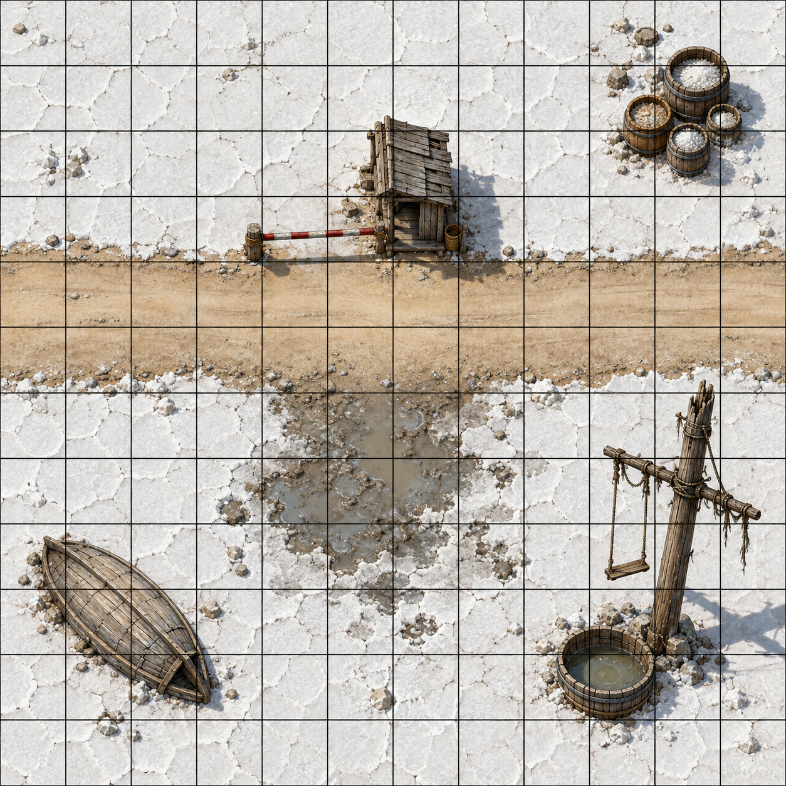
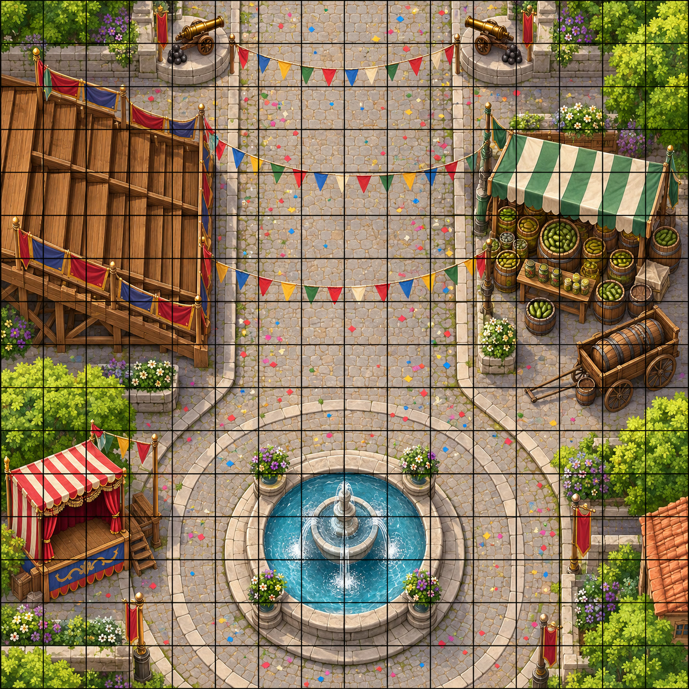

# Combat Tracker — The Tide Festival

**Two real fights.** Encounter 1 is **avoidable** — the Brack Brothers can be bought off, bluffed, or scared away — but if it comes to blows they fight to win. Encounter 2 is the session's big set piece: an animated parade float with a crowd to save, three ways to stop it, and Lord Gullwhistle making his last try for the ledger. **Normal rules apply:** a PC who drops to 0 HP makes death saves. Villains dropped by melee can be knocked out instead of killed, as usual.

**Party: four PCs at Level 6.** 2014 DMG per-PC thresholds — **Easy 300 · Medium 600 · Hard 900 · Deadly 1,400** — so at **4 PCs**: **Easy 1,200 · Medium 2,400 · Hard 3,600 · Deadly 5,600.** Every stat block is **⚗️ homebrew** except Clacker (a *Monster Manual* giant crab); CRs are provisional budget ratings.

> [!NOTE]
> **Tactical maps are generated.** The written distances and terrain below remain authoritative if the artwork differs. Exact prompts are in `images/images.json`.

---

## Encounter 1 — The Brack Brothers' Roadblock

*Act I, Scene 1.1 · Avoidable · Medium (1,375 XP × 2 = 2,750 adjusted / Medium 2,400 – Hard 3,600 at 4×L6)*

### Summary

| | |
|---|---|
| **Location** | The salt road, about six miles east of the Sarshel Light, two hours after sunrise. An old salt-collector's hut ringed with salvage, a striped gate pole, salt barrels, an upturned rowboat, a broken mast hung with salvage rigging, and Clacker's brine tub. |
| **Light** | Bright morning sun. |
| **Terrain** | Flat salt flat; a 15-ft road; a patch of **wet salt mud** (difficult terrain); props anyone can use (see *Triggers*). |
| **Antagonists** | **Mort Brack**, **Ned Brack**, **Ollie Brack** (CR 2 provisional each, ⚗️) + **Clacker** (giant crab, CR 1/8) |
| **Party** | **4 PCs at L6** — Naan, Nalith, Kto, Yinu. |
| **XP** | 450 × 3 + 25 = 1,375 × **2** (four creatures) = **2,750 → Medium.** |
| **Duration** | 3–4 rounds. |
| **Goal (PCs)** | Get the walkers past — by any means. |
| **Goal (Bracks)** | Take every book and paper from the lighthouse folk, and turn them back into the salt. |
| **Avoid it** | Hand over the ledger; **buy them off** (Persuasion DC 13 with 50+ gp, automatic at 100 gp); **bluff** with decoy papers (Deception DC 14); or **scare them off** (Intimidation DC 15, advantage after a show of real power). See File 1, Scene 1.1. |
| **Morale** | They surrender when **Mort drops** or **two brothers are at 0 HP**. With Mort down and the road open, Ned runs; Ollie stays with his fallen brothers. |

### Round Strip & Initiative

**Round:** ☐ 1 · ☐ 2 · ☐ 3 · ☐ 4 · ☐ 5 · ☐ 6

NPC initiative is pre-rolled (`round(avg(1d20 + DEX))`). PCs roll live and write into the blank rows.

| Init | Combatant | AC | HP | Notes |
|---|---|---|---|---|
| __ | _________________ | __ | _________________ | _________________ |
| 14 | Ned Brack | 14 | 44: ☐☐☐☐☐ ☐☐☐☐☐ ☐☐☐☐☐ ☐☐☐☐☐ ☐☐☐☐☐ ☐☐☐☐☐ ☐☐☐☐☐ ☐☐☐☐☐ ☐☐☐☐ | Caltrops ☐ |
| 13 | Mort Brack | 15 | 52: ☐☐☐☐☐ ☐☐☐☐☐ ☐☐☐☐☐ ☐☐☐☐☐ ☐☐☐☐☐ ☐☐☐☐☐ ☐☐☐☐☐ ☐☐☐☐☐ ☐☐☐☐☐ ☐☐☐☐☐ ☐☐ | Net ☐ (Recharge 5–6) |
| 13 | Clacker | 15 | 13: ☐☐☐☐☐ ☐☐☐☐☐ ☐☐☐ | Tub at half HP |
| __ | _________________ | __ | _________________ | _________________ |
| __ | _________________ | __ | _________________ | _________________ |
| 10 | Ollie Brack | 13 | 67: ☐☐☐☐☐ ☐☐☐☐☐ ☐☐☐☐☐ ☐☐☐☐☐ ☐☐☐☐☐ ☐☐☐☐☐ ☐☐☐☐☐ ☐☐☐☐☐ ☐☐☐☐☐ ☐☐☐☐☐ ☐☐☐☐☐ ☐☐☐☐☐ ☐☐☐☐☐ ☐☐ | Grappling: ☐ |
| __ | _________________ | __ | _________________ | _________________ |

**Conditions:** Bln · Chr · Deaf · Frt · Grp · Inc · Inv · Prl · Pet · Pzn · Prn · Rst · Stn · Uns · Conc

### Triggers & Countdowns

- **Opening.** Mort talks first. Unless the party attacks or one of the *Avoid it* options lands, Ned opens from behind the rowboat and Ollie comes round the barrels. The walkers pull back 60 ft to Dagna's wagon and stay out of the fight.
- **Surrender.** When **Mort drops** or **two brothers are at 0 HP**, the rest throw down their weapons: *"Enough! Enough. You've made your point."* They trade information for their lives (the gent's description and the "G." note).
- **The gate pole.** Anyone next to the hut can drop the striped pole as a bonus action: one creature on the road beside the hut makes a **DC 12 Dex save** or falls prone.
- **Salt barrels.** Anyone next to the barrel stack can tip one as an action: a 15-ft line of rolling barrel, **DC 12 Dex save** or **1d6 bludgeoning** and prone.
- **The salvage rigging.** A creature next to the mast can swing up to 20 ft on the hanging ropes as part of its move without provoking opportunity attacks (**Acrobatics DC 10**, or land prone at the end).
- **The hut.** Full cover inside. Any single hit of 10+ bludgeoning or force damage on the hut knocks a wall flat; whoever is inside is now in the open.
- **The walkers.** If a Brack moves toward the wagon, call it out first. Oren and Dagna will put themselves between him and the children; give the party a turn to answer before anything happens to them.

### Tactics Summary

- **Mort Brack** — R1: throws the **Weighted Net** at the most dangerous-looking caster, then calls targets for his brothers. R2+: cudgels whoever is netted or prone, and **Parries** the biggest hit. Surrenders for everyone when it's clearly lost.
- **Ned Brack** — Stays behind the rowboat, slings at casters and archers, and scatters **caltrops** in the path of anyone charging him.
- **Ollie Brack** — Charges the nearest melee PC, grapples, and throws them into the mud or the barrels. Goes straight for anyone who drops a brother (*Brother's Keeper*).
- **Clacker** — Grapples whoever Ollie is fighting; retreats to the tub at half HP.

### Loot / Aftermath

- **Mort's purse: 25 gp** — Gullwhistle's down payment.
- **The "G." note** in Mort's coat (see File 1, Scene 1.1).
- **Salvage** around the hut: rope, tar, ship's brass, and a good spyglass (worth 25 gp in the city, if the party wants it).
- **What happens to the Bracks:** see File 1, Scene 1.1 *Conditional follow-through*.

### Mort Brack

> Lean and sharp-featured, black moustache, long weathered grey coat, a weighted net over one shoulder. Polite, and never means it.

**Medium humanoid (human), Neutral Evil, ⚗️ homebrew · CR 2 provisional (450 XP)**

| | |
|---|---|
| **AC** | 15 (studded leather) |
| **HP** | **52** (8d8 + 16) · **Bloodied 26** |
| **Speed** | 30 ft. |
| **STR / DEX / CON** | 14 (+2) · 14 (+2) · 14 (+2) |
| **INT / WIS / CHA** | 12 (+1) · 11 (+0) · 15 (+2) |
| **Skills** | Deception +4, Intimidation +4, Perception +2 |
| **Senses** | Passive Perception 12 |
| **Languages** | Common |

**Actions.** ***Multiattack.*** Two **Cudgel** attacks. ***Cudgel.*** Melee, reach 5 ft., **+4**, **1d8 + 2 bludgeoning**. ***Weighted Net (Recharge 5–6).*** Ranged 15 ft., **+4** against a Large or smaller creature: the target is **restrained** until it or a creature next to it uses an action to make a **DC 12 Strength** check and pulls free, or the net (AC 10, 5 HP) is cut.

**Reactions.** ***Parry.*** Mort adds 2 to his AC against one melee attack that would hit him, if he can see the attacker.

### Ned Brack

> Wiry and squinting, a leather bandolier of lead shot across his chest, a sling always turning in his hand. Says almost nothing.

**Medium humanoid (human), Neutral Evil, ⚗️ homebrew · CR 2 provisional (450 XP)**

| | |
|---|---|
| **AC** | 14 (leather) |
| **HP** | **44** (8d8 + 8) · **Bloodied 22** |
| **Speed** | 30 ft. |
| **STR / DEX / CON** | 10 (+0) · 17 (+3) · 12 (+1) |
| **INT / WIS / CHA** | 11 (+0) · 13 (+1) · 10 (+0) |
| **Skills** | Perception +3, Stealth +5 |
| **Senses** | Passive Perception 13 |
| **Languages** | Common |

**Traits.** ***Wrecker's Eye.*** Long range doesn't give Ned disadvantage, and his sling attacks ignore half cover.

**Actions.** ***Multiattack.*** Two **Lead-Shot Sling** attacks. ***Lead-Shot Sling.*** Ranged 30/120 ft., **+5**, **1d6 + 3 bludgeoning**.

**Bonus Actions.** ***Caltrop Scatter (once per fight).*** Ned throws a bag of caltrops to cover a 10-ft. square within 20 ft. A creature that enters the area makes a **DC 13 Dex save** or stops moving and takes **1 piercing damage**, and its speed drops by 10 ft. until it regains at least 1 HP.

### Ollie Brack

> Huge and bald, scarred knuckles wrapped in cloth. Quiet, devoted to his brothers, and very strong.

**Medium humanoid (human), Neutral, ⚗️ homebrew · CR 2 provisional (450 XP)**

| | |
|---|---|
| **AC** | 13 (hide) |
| **HP** | **67** (9d8 + 27) · **Bloodied 33** |
| **Speed** | 30 ft. |
| **STR / DEX / CON** | 18 (+4) · 9 (−1) · 16 (+3) |
| **INT / WIS / CHA** | 8 (−1) · 10 (+0) · 9 (−1) |
| **Skills** | Athletics +6 |
| **Senses** | Passive Perception 10 |
| **Languages** | Common |

**Traits.** ***Brother's Keeper.*** When a creature Ollie can see drops one of his brothers to 0 HP, Ollie can use his reaction to move up to his speed toward that creature.

**Actions.** ***Multiattack.*** Two **Fist** attacks; he can replace one with **Grab**. ***Fist.*** Melee, reach 5 ft., **+6**, **1d8 + 4 bludgeoning**. ***Grab.*** Melee, reach 5 ft., **+6**: the target is **grappled** (escape DC 14). He can grapple one creature at a time. ***Throw.*** Ollie throws a Medium or smaller creature he is grappling up to 15 ft.: it takes **2d6 + 4 bludgeoning** and lands prone.

### Clacker (Giant Crab)

> A big red crab in a battered rope harness. The Bracks use it to drag salvage off the wrecks.

**Medium beast, unaligned · CR 1/8 (25 XP)** — *Monster Manual* giant crab.

| | |
|---|---|
| **AC** | 15 (natural armor) |
| **HP** | **13** (3d8) · **Bloodied 6** |
| **Speed** | 30 ft., swim 30 ft. |
| **STR / DEX / CON** | 13 (+1) · 15 (+2) · 11 (+0) |
| **INT / WIS / CHA** | 1 (−5) · 9 (−1) · 3 (−4) |
| **Skills** | Stealth +4 |
| **Senses** | Blindsight 30 ft., Passive Perception 9 |
| **Languages** | — |

**Traits.** ***Amphibious.*** Breathes air and water.

**Actions.** ***Claw.*** Melee, reach 5 ft., **+3**, **1d6 + 1 bludgeoning**, and the target is **grappled** (escape DC 11). It has two claws, each able to grapple one target.

---

## Encounter 1 — Tactical Layout *(written dimensions remain authoritative)*

**Grid: 1 square = 5 ft. Field is 60 ft. × 60 ft. (12 × 12 squares), north up.** The party and the walkers come in from the **west edge** on the road; the walkers pull back 60 ft., off the map.

- **The road** runs west to east across the middle of the field, **15 ft. wide**, from 25 ft. to 40 ft. south of the north edge.
- **The hut** — **10 × 10 ft.**, just north of the road at the field's centre. Full cover inside. Mort starts at the gate pole beside it.
- **The gate pole** lies across the road on the hut's east side.
- **Salt barrels** — a **10 × 10 ft.** stack in the north-east corner area. Half cover. Ollie starts behind them (Perception DC 13 to spot).
- **Upturned rowboat** — **10 × 5 ft.**, south-west of the road. Half cover (which Ned's own shots ignore). Ned starts behind it.
- **Broken mast and salvage rigging** — south-east of the road; **Clacker's brine tub** sits beside it.
- **Wet salt mud** — a **15 × 15 ft.** patch just south of the road, centre field. Difficult terrain.
- **Distances:** west edge → hut **25 ft.**; hut → barrels **20 ft.**; hut → rowboat **30 ft.**; hut → mast **25 ft.**

---

## Encounter 2 — The Grand Sea-Serpent Float

*Act III, Scene 3.1 · Hard (2,450 XP × 2 = 4,900 adjusted / Hard 3,600 – Deadly 5,600 at 4×L6)*

### Summary

| | |
|---|---|
| **Location** | **Harbor Way** at sunset — a 30-ft-wide festival street running south to the harbor plaza and its big round fountain. Grandstands, a pickle stall, a puppet show, two confetti cannons. |
| **Light** | Bright — sunset plus lanterns everywhere. |
| **Terrain** | Cobbles; the **fountain** (20 ft. across, 2 ft. deep: difficult terrain); confetti and lantern paper everywhere. |
| **Antagonists** | **Lord Percival Gullwhistle** (CR 2 provisional, ⚗️) + 1× **Grand Sea-Serpent Float** (CR 5 provisional, ⚗️) + 2× **Clockwork Gull** (CR 1/2 provisional, ⚗️) |
| **Bystanders** | Three **crowd groups** in the float's path: **A — the grandstand**, **B — the pickle stall**, **C — the puppet show** (little kids). |
| **Party** | **4 PCs at L6** — Naan, Nalith, Kto, Yinu. |
| **XP** | 1,800 + 450 + 100 × 2 = 2,450 × **2** (four creatures) = **4,900 → Hard.** |
| **Duration** | 4–5 rounds. |
| **Goal (PCs)** | Stop the float, save the crowd, keep the ledger, and catch Gullwhistle. |
| **Goal (Gullwhistle)** | Get the ledger (the gulls snatch it); failing that, escape to his rowboat off the south edge. |
| **Three ways to stop the float** | **(1)** Reduce it to 0 HP. **(2)** ***Dispel Magic*** (see *Triggers*). **(3)** Climb aboard and turn the **brass wind-key** twice. |
| **Where Gullwhistle starts** | **Not exposed:** front row of the grandstand (Crowd A), reading the scroll quietly. **Exposed:** riding the float's back. |

### Round Strip & Initiative

**Round:** ☐ 1 · ☐ 2 · ☐ 3 · ☐ 4 · ☐ 5 · ☐ 6 · ☐ 7 · ☐ 8

NPC initiative is pre-rolled (`round(avg(1d20 + DEX))`). PCs roll live and write into the blank rows.

| Init | Combatant | AC | HP | Notes |
|---|---|---|---|---|
| __ | _________________ | __ | _________________ | _________________ |
| 14 | Lord Gullwhistle | 15 | 52: ☐☐☐☐☐ ☐☐☐☐☐ ☐☐☐☐☐ ☐☐☐☐☐ ☐☐☐☐☐ ☐☐☐☐☐ ☐☐☐☐☐ ☐☐☐☐☐ ☐☐☐☐☐ ☐☐☐☐☐ ☐☐ | Charm ☐ · Ledger ☐ |
| __ | _________________ | __ | _________________ | _________________ |
| 13 | Clockwork Gull A | 13 | 22: ☐☐☐☐☐ ☐☐☐☐☐ ☐☐☐☐☐ ☐☐☐☐☐ ☐☐ | Carrying: ________ |
| 13 | Clockwork Gull B | 13 | 22: ☐☐☐☐☐ ☐☐☐☐☐ ☐☐☐☐☐ ☐☐☐☐☐ ☐☐ | Carrying: ________ |
| __ | _________________ | __ | _________________ | _________________ |
| __ | _________________ | __ | _________________ | _________________ |
| 10 | Grand Sea-Serpent Float | 15 | 136 — cross off each 10 lost: ☐☐☐☐☐ ☐☐☐☐☐ ☐☐☐ · last 6 ☐ | Bloodied at 68 · Wind-key ☐☐ · Steam ☐ |

**Crowd groups:** A — grandstand ☐ saved ☐ scattered · B — pickle stall ☐ saved ☐ scattered · C — puppet show ☐ saved ☐ scattered

**Conditions:** Bln · Chr · Deaf · Frt · Grp · Inc · Inv · Prl · Pet · Pzn · Prn · Rst · Stn · Uns · Conc

### Triggers & Countdowns

- **Before initiative — who has the ledger?** Ask the table which PC is carrying it (or whether it was left with Plumm or Amsel). If nobody has it, the gulls attack PCs instead.
- **Round 1 — Waking Up.** Gullwhistle reads the scroll on his first turn (it crumbles to glowing ash). On its first turn the float only grinds, shudders, and hisses steam: **it does not move.** Every PC gets a turn to react before it rolls.
- **Runaway.** From round 2, at the start of each of its turns the float rolls up to 30 ft. toward the **nearest crowd group not yet saved or scattered**. **Distracted:** if any creature hit it since its last turn, it rolls toward the creature that hit it most recently instead, and attacks that creature. Hitting it is how you pull it away from the crowd. When no crowd groups are left, it chases whoever hit it last.
- **Crowd groups.** A PC within 10 ft. of a group can use an action to get them clear — shouting, herding, carrying kids, a clever spell. No roll for a sensible plan; DC 10 for a wild one. Mark it **saved**. If the float reaches a group that hasn't been saved, that group **scatters**: stalls smashed and several people hurt (nobody dies; the Hall's healers see to them overnight). It isn't saved.
- **Dispel Magic.** The *Scroll of the Rising Tide* ⚗️ is a **5th-level** effect: ***dispel magic*** cast with a 5th-level slot ends it automatically; with a lower slot, make a spellcasting ability check, **DC 15**. When it ends, the float rolls down into the fountain and stops.
- **The brass wind-key.** A creature next to the float can climb aboard as part of its move (**Athletics or Acrobatics DC 13**, costs 10 ft.; automatic for the first PC to try **if Marisol shouted the secret** in round 1). Aboard, it moves with the float; Chomp can't reach it, but Tail Swipe can — on a hit, the rider is also thrown 10 ft. off the float and lands prone. Turning the key is an action with a **DC 13 Strength (Athletics)** check; **two successes** wind it down and it rolls into the fountain.
- **The ledger.** A clockwork gull can use **Snatch** on the carrier (DC 12 Dex save). A gull carrying the ledger flies toward Gullwhistle; if it ends its turn within 5 ft. of him, he takes it (no action). A gull that takes any damage while carrying it drops it in its space.
- **Gullwhistle's escape.** His rowboat waits at the quay steps just beyond the **south edge** of the harbor plaza. If he leaves the map by the south edge, he is gone. Telegraph it: anyone looking south sees an oarsman waiting with his oars up.
- **Gullwhistle's surrender.** At **15 HP or fewer** with no way out (charm spent, path south blocked), he yields and demands the Council.
- **Area spells near crowds.** Before anyone casts *fireball*, *lightning bolt*, or another area spell, warn the table if the area touches an unsaved crowd group. If they cast anyway, the crowd is caught: those people are hurt, and the group counts as **scattered**.
- **Hazards anyone can use:** a **confetti cannon** (action, adjacent PC: 30-ft. line, **DC 13 Con save** or blinded until the end of the target's next turn — works on the float, the gulls, and Gullwhistle); a **fountain water jet** (action, adjacent PC: 30-ft. line, **DC 13 Str save** or pushed 10 ft. and prone — the Huge float is only pushed, never knocked prone); **pickle barrels** at stall B (action: 15-ft. line, **DC 12 Dex save** or **1d6 bludgeoning** and prone).
- **Allies who may arrive:** the **Brack Brothers** (if they went free in 1.1) clear one crowd group on round 2; **Lady Marisol** (if she switched sides in 2.2) shouts the wind-key secret on round 1.
- **When the float stops:** it ends in the fountain with a long dying whistle of steam. The gulls drop out of the sky and lie on the cobbles, ticking. If Gullwhistle is still free, he runs for the boat. Go to Scene 3.2 once he is taken or gone.

### Tactics Summary

- **Lord Gullwhistle** — R1: reads the scroll. R2+: **whistles** a gull at the ledger carrier and works his way south toward the quay. Fights with his rapier only when cornered; uses the **Sea-Glass Charm** to break away when a PC blocks him. **Parries** the first big hit each round.
- **Grand Sea-Serpent Float** — R1: wakes up (no move). R2+: Runaway toward the nearest unsaved crowd, Chomp whatever is in front of it, Tail Swipe anyone behind or beside it. Uses **Steam Breath** whenever it recharges and three or more creatures are in the cone.
- **Clockwork Gulls** — **Snatch** at the ledger carrier and fly it to Gullwhistle; otherwise dive-bomb whoever is hurting him.

### Loot / Aftermath

- **On Gullwhistle** (if taken): Veyra's letter, the scroll's ash, the Sea-Glass Charm (spent; a pretty bauble now), his **gold gull pin**, his rapier, and the ledger if the gulls brought it to him.
- **The float's wreck**: brass gears, painted canvas, and a great grinning wooden head the festival keeps as a reminder.
- **Rewards** come in Scene 3.2 (justice, the crowd's cheers, Heroic Inspiration if all three groups were saved) — see File 1 *Loot & Rewards Summary*.

### Lord Percival Gullwhistle

> Slim and elegant, silver-streaked ginger beard, teal-and-gold frock coat, a gull feather in his tricorn, a gold gull pin, a rapier he knows how to use. Gracious to the very end.

**Medium humanoid (human), Neutral Evil, ⚗️ homebrew · CR 2 provisional (450 XP)**

| | |
|---|---|
| **AC** | 15 (fine brigandine under his coat) |
| **HP** | **52** (8d8 + 16) · **Bloodied 26** |
| **Speed** | 30 ft. |
| **STR / DEX / CON** | 10 (+0) · 16 (+3) · 14 (+2) |
| **INT / WIS / CHA** | 14 (+2) · 12 (+1) · 17 (+3) |
| **Saving Throws** | Dex +5, Wis +3 |
| **Skills** | Deception +7, Insight +3, Persuasion +7 |
| **Senses** | Passive Perception 11 |
| **Languages** | Common, Elvish |

**Actions.** ***Multiattack.*** Two **Rapier** attacks. ***Rapier.*** Melee, reach 5 ft., **+5**, **1d8 + 3 piercing**.

**Bonus Actions.** ***Silver Gull-Whistle.*** One clockwork gull within 60 ft. that can hear him uses its reaction to fly up to 25 ft. and make one Peck or Snatch. ***Sea-Glass Charm (once).*** In a swirl of salt mist, Gullwhistle teleports up to 30 ft. to an unoccupied space he can see.

**Reactions.** ***Parry.*** Gullwhistle adds 2 to his AC against one melee attack that would hit him, if he can see the attacker.

### Grand Sea-Serpent Float

> A house-sized clockwork sea serpent of painted wood, canvas, and brass gears, teal-and-gold scales, its painted grin split open into rows of brass teeth, glass eyes glowing sea-green, steam hissing from its jaws, and a big brass wind-key on its back.

**Huge construct, unaligned, ⚗️ homebrew · CR 5 provisional (1,800 XP)**

| | |
|---|---|
| **AC** | 15 (painted planks) |
| **HP** | **136** (13d12 + 52) · **Bloodied 68** |
| **Speed** | 30 ft. (wheels; it cannot climb) |
| **STR / DEX / CON** | 20 (+5) · 8 (−1) · 18 (+4) |
| **INT / WIS / CHA** | 3 (−4) · 10 (+0) · 1 (−5) |
| **Damage Immunities** | Poison, psychic |
| **Condition Immunities** | Charmed, exhaustion, frightened, paralyzed, petrified, poisoned |
| **Senses** | Darkvision 60 ft. (glass eyes), Passive Perception 10 |
| **Languages** | — |

**Traits.** ***Animated by the Scroll.*** A 5th-level magical effect; see *Dispel Magic* in Triggers. ***Runaway / Distracted / Waking Up.*** See Triggers. ***Brass Wind-Key.*** Two successful DC 13 Strength (Athletics) actions by a creature aboard stop it.

**Actions.** ***Multiattack.*** One **Chomp** and one **Tail Swipe**. ***Chomp.*** Melee, reach 10 ft., **+7**, **3d8 + 5 piercing**. ***Tail Swipe.*** Melee, reach 15 ft., **+7**, **2d8 + 5 bludgeoning**, and the target makes a **DC 15 Str save** or falls prone. ***Steam Breath (Recharge 5–6).*** Replaces Multiattack. A 30-ft. cone of scalding steam: each creature in it makes a **DC 14 Dex save**, taking **4d6 fire damage** on a failed save, or half as much on a success.

**On 0 HP.** It collapses into the fountain in a heap of canvas, springs, and steam.

### Clockwork Gull

> A brass seagull the size of a cat, the Gull Club's mascot, flapping on wind-up wings. It turns its head whenever the silver whistle blows.

**Small construct, unaligned, ⚗️ homebrew · CR 1/2 provisional (100 XP)**

| | |
|---|---|
| **AC** | 13 |
| **HP** | **22** (5d6 + 5) · **Bloodied 11** |
| **Speed** | 10 ft., fly 50 ft. |
| **STR / DEX / CON** | 8 (−1) · 14 (+2) · 12 (+1) |
| **INT / WIS / CHA** | 3 (−4) · 10 (+0) · 5 (−3) |
| **Damage Immunities** | Poison |
| **Condition Immunities** | Poisoned |
| **Senses** | Passive Perception 10 |
| **Languages** | — |

**Traits.** ***Flyby.*** Doesn't provoke opportunity attacks when it flies out of an enemy's reach. ***Dive-Bomb.*** If it flies at least 20 ft. straight toward a target and then hits it with Peck, the target makes a **DC 12 Str save** or falls prone.

**Actions.** ***Peck.*** Melee, reach 5 ft., **+4**, **1d6 + 2 piercing**.

**Bonus Actions.** ***Snatch.*** One creature within 5 ft. carrying a small object the gull is after (the ledger, if Gullwhistle has whistled for it) makes a **DC 12 Dex save** or the gull takes it. It can't take a weapon or a spellcasting focus that is being held.

**On 0 HP.** Drops out of the air and lies on the cobbles, ticking. Anything it carried falls in its space.

---

## Encounter 2 — Tactical Layout *(written dimensions remain authoritative)*

**Grid: 1 square = 5 ft. Field is 80 ft. × 80 ft. (16 × 16 squares), north up.** The float starts at the north edge; the party is at the front of the parade, about **30 ft. south of the float**, in the middle of the street.

- **Harbor Way** — a **30-ft.-wide** cobbled street running north to south down the middle of the field.
- **The float** starts at the **north edge, centred on the street** (Huge, 15 × 15 ft.). If the club was exposed, Gullwhistle is on its back.
- **Crowd A — the grandstand** — wooden bleachers **15 × 30 ft.** on the street's **west** side, starting 15 ft. from the north edge. If the club wasn't exposed, Gullwhistle starts in its front row.
- **Crowd B — the pickle stall** — a stall and a parked cart, **15 × 15 ft.**, on the street's **east** side, starting 25 ft. from the north edge. Dagna's barrels are here.
- **Crowd C — the puppet show** — a striped booth, **10 × 10 ft.**, **south-west**, beside the fountain.
- **The harbor plaza** fills the **southern 20 ft.** of the field; the **fountain** is **20 ft. across**, centred in the plaza. **The quay steps and Gullwhistle's rowboat** are just beyond the south edge.
- **Confetti cannons** — one at each **north corner** of the street.
- **Distances:** float → party **30 ft.**; float → grandstand **~15 ft.**; float → pickle stall **~25 ft.**; float → puppet show **~45 ft.**; float → fountain **~45 ft.**; grandstand front row → south edge **~50 ft.**

---

