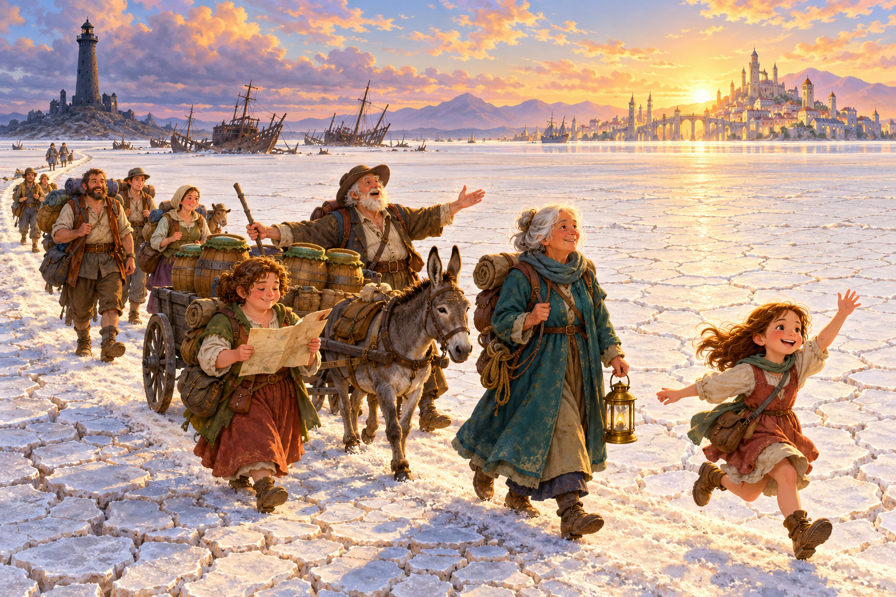
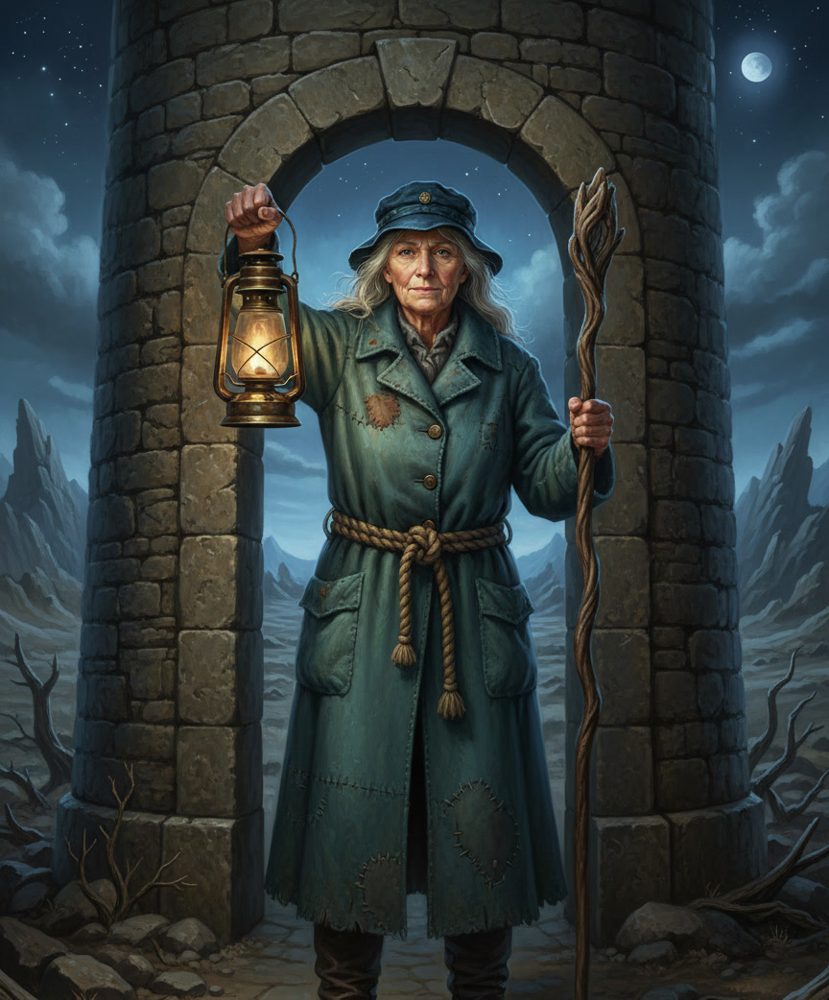
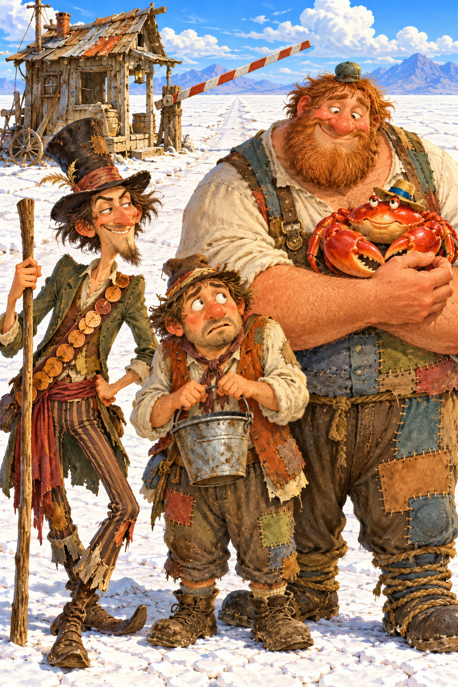
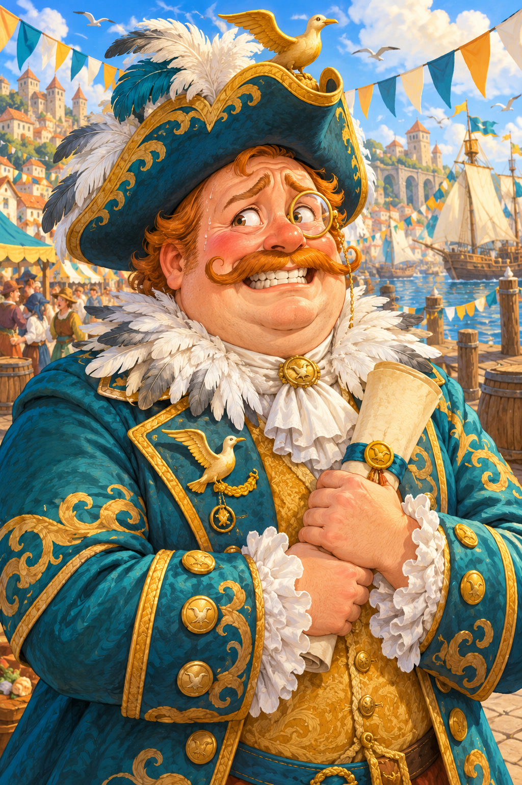
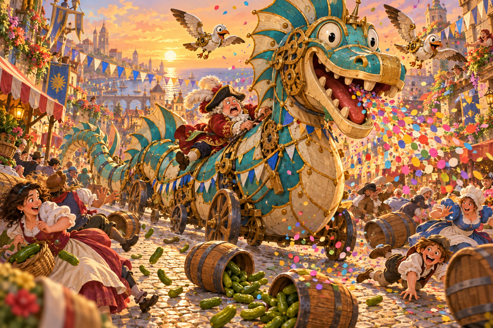

# Player Handouts — The Tide Festival

*Session 008 · Show each picture at the table when the party meets that person or place — not all at once, and not before.*

> [!NOTE]
> **Portrait pages are image and name only.** Each portrait page holds one picture scaled to fill the sheet and the name in large bold type at the foot of the page, added by the PDF renderer. The artwork has no lettering of its own. Read the cues from File 1 aloud.

---

# Where We Left Off

**Last session (007):** Oberon's portal dropped you at night on the dried-up bed of the Sea of Fallen Stars, where a lighthouse with no sea to warn swept its beam over you, and each of you saw the thing you wanted most — and believed it was waiting inside the tower. At the stranded ship *Embergull*, the camp keeper Oren fed you soup and warned you that the light eats people. **Yinu** tried to fly to the tower and **vanished in the beam** — and woke up **chained in the lantern room** with four other prisoners, then Misty Stepped free. At the door, **Nalith** broke the keeper **Tamsin Reed**'s spell with *dispel magic*, and Tamsin led you to the top.

In the lantern room, a woman named **Veyra** was calling up a **Brine Fiend** to eat the prisoners. **Kto**'s arrows, **Naan**'s *cloud of daggers*, and Yinu's shadowspawn wore them down, and **Yinu's lightning bolt** finished Veyra — the demon fell apart into a puddle of salt water. Tamsin turned her key and **the light went out**. You freed the four prisoners and found Veyra's **ledger**: a list of people in the city of **New Sarshel** who paid her for her work.

**Today:** the sun is coming up, the lighthouse is dark behind you, and about fifteen grateful people are walking with you nine miles east to New Sarshel.

---

## New Sarshel at the Tide Festival

*(Show when the party reaches the city.)*

- A harbor city of pale stone towers and red roofs that **chased the sea**: when the water drew back, New Sarshel built new docks to follow it, and grew rich.
- Every balcony has a paper lantern. Every street has bunting. Somebody is always playing a fiddle.
- It is the **Tide Festival**, and everyone already seems to know who you are.

---

## Tamsin Reed

## The Brack Brothers

## Lord Percival Gullwhistle

## Tibbet Sparkwright

## The Grand Sea-Serpent Float

*(Show when the float wakes up at the Grand Parade.)*

- A house-sized clockwork sea serpent of painted wood and brass gears, teal and gold, with a goofy grin — and it's moving.
- Confetti everywhere. Squeaky wheels. Somebody shouting "RISE, O SEA!"

---

# Handout — The Tide Festival Schedule

*(Warden Plumm hands this out at the gate in Scene 1.2.)*

**THE TIDE FESTIVAL OF NEW SARSHEL** — *the city that caught the sea!*

**Lantern Eve**
- All day — stalls open on Festival Green
- Dusk — **Harbor Lanterns**: float a lantern for someone you miss or something you hope for

**Tide Day**
- Noon — **The Noon Bells** and the Blessing of the Tide at the Hall of Many Lights
- Afternoon — **Festival Games** on Festival Green: the Archery Contest · the Crab Races · the Pickle-Eating Contest (*no pickled eggs this year, by request*)
- Sunset — **The Grand Parade** down Harbor Way to the fountain, featuring the Gilded Gull Club's famous Sea-Serpent Float
- Nightfall — **Fireworks** over the harbor by Tibbet Sparkwright

*Heroes of the lighthouse ride at the front of the parade, free!*

---

# Handout — Veyra's Ledger

*(The party already has this. Read or show it whenever they look at it.)*

A small leather book in a neat hand. Most pages are notes in a fiery script you can't read. One page is a list:

- **Lord Percival Gullwhistle** — 400 gp — *for the Summoning*
- **Lady Marisol Brightwater** — 400 gp — *for the Summoning*
- **Sir Dunstan Pellow** — 400 gp — *for the Summoning*

Under the list, underlined twice: *"G.G.C. — pay on the full moon."*
